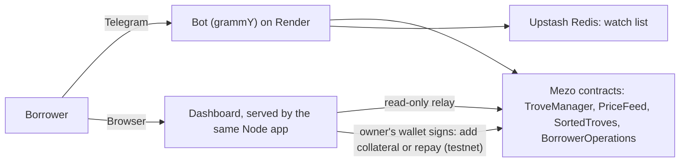

# Trove Guardian

A Telegram bot and web dashboard that warns Mezo MUSD borrowers before their Bitcoin-backed loan is liquidated, shows how close a loan is to the redemption queue, and lets a testnet owner top the loan up in one tap.

- Live: https://trove-guardian.onrender.com
- Bot: https://t.me/TroveGuardianAman_bot
- Video: https://youtu.be/jb3sczsmqQk
- Evidence of testing: [docs/EVIDENCE.md](docs/EVIDENCE.md)

Status: working on Mezo testnet (rescue) and Mezo mainnet (read-only).

## Try it in 60 seconds
1. Open the dashboard and click **Try a testnet loan**, or **Try a mainnet loan** for live Mezo mainnet data (read-only): https://trove-guardian.onrender.com
2. Open the bot and send `/riskiest`, then tap an address to copy it and send `/status` followed by the address: https://t.me/TroveGuardianAman_bot
3. Tap the buttons under the reply (BTC -40%, How to fix, Redemption rank).
4. The one-tap rescue needs the owner's wallet, so it is shown in the demo video and in [docs/EVIDENCE.md](docs/EVIDENCE.md) with its testnet transactions.

## What it does
- Reads a Trove's collateral, debt and the BTC price from Mezo's contracts and shows the liquidation price and the buffer, on mainnet or testnet.
- Telegram alerts at warning and critical levels the user chooses, with hysteresis so alerts do not flap.
- `/simulate` shows what happens if BTC falls by X%. `/fix` shows how much BTC to add or MUSD to repay, respecting Mezo's minimum debt.
- `/rank` and `/riskiest` use Mezo's sorted list of Troves to show a loan's place in the redemption queue and the lowest-ratio Troves.
- Tells you when the price feed cannot be read, or when your Trove was closed, liquidated or redeemed.
- Dashboard "Rescue this loan" (testnet): connect the owner wallet, then add collateral or repay MUSD. Each action is simulated before the wallet is asked to sign.

## Architecture

## How it works
Mezo contracts (TroveManager, PriceFeed, BorrowerOperations, SortedTroves) are read with ethers.js, trying several RPC providers in turn. The bot (grammY) polls every minute. The watch list is stored in Upstash Redis so it survives restarts. A small Node server serves the dashboard and forwards read-only RPC calls. It is hosted on Render.

## Bot commands
`/watch <address> [warn%] [critical%] [mainnet|testnet]`, `/unwatch <address>`, `/list`, `/status <address>`, `/simulate <address> <drop%>`, `/fix <address>`, `/rank <address>`, `/riskiest [mainnet|testnet]`

## Run it yourself
1. `npm install`
2. Create a bot with @BotFather and copy `.env.example` to `.env`, then set `BOT_TOKEN`.
3. `node --env-file=.env src/index.js`
4. Optional settings are listed in `.env.example` (Redis, public URL, RPC endpoints).
5. `npm test` runs the 16 automated tests (risk math and the dashboard server). `npm run verify -- 0xOwner` checks the contract calls against a real Trove.

## Limits
- The bot never holds keys or sends transactions. Rescues are signed by the owner in their own wallet, on testnet only.
- Mainnet is read-only. Only a few Troves are open on mainnet right now, so the audience today is small.
- The rescue needs an EVM wallet (for example Rabby). Bitcoin-wallet sign-in through Mezo Passport is not supported.
- Premium alerts (more wallets, email and phone calls) are planned and not built.
